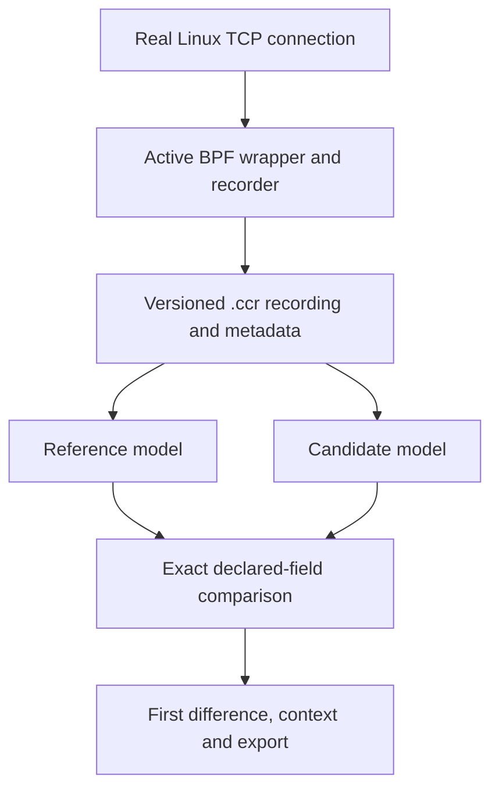

# Architecture

[Project home](../README.md)

## The problem

A change to congestion-control code may alter a callback's decision long before a developer can understand the resulting graph. Thousands of callback invocations can sit between a source edit and a visible networking symptom. CCReplay localizes the first implementation difference on a recorded callback sequence.

The intended user is a developer testing or debugging congestion-control logic. The project contributes an explicit recording contract, a real Linux callback recorder, userspace models, comparison oracles and a differential debugging interface.

## The data path

This is callback replay, not packet capture or whole-TCP replay. The `.ccr` format is not PCAP. The trace contains what the congestion controller saw and computed at its callback boundary.

## Responsibilities

| Component | Responsibility | Main source |
|---|---|---|
| Active recorder | Execute the selected controller and capture its callback boundary | `bpf/*_wrapper.bpf.c` |
| Userspace consumer | Load/register the wrapper, drain records and finalize metadata | `user/ccr_recorder*.c` |
| Trace parsers | Enforce versioned layout and validate records/metadata | `user/ccr_trace*.py` |
| Controller models | Compute callback output and private next state | `user/*_model.py` and variants |
| Comparison engine | Replay compatible models and identify semantic differences | `user/ccreplay_diff.py`, `ccreplay/diff.py` |
| Checkpoint engine | Store pre-event private state and resume at that event through the divergence (schema 2) | `user/ccreplay_checkpoint.py` |
| Application adapters | Expose recordings, controller revisions, replay sessions and jobs | `ccreplay/`, `backend/` |
| Web interface | Select inputs, execute comparisons and inspect returned data | `frontend/src/` |
| Network Lab (verified on the identified WSL host) | Owned namespace topology, workload, telemetry and recording registration | `ccreplay/lab_*.py`, `backend/lab.py`, `scripts/start_lab_agent.sh` |

The Python engine computes the result. The frontend must not recalculate or invent controller decisions.

## What the recorder does

The BPF wrapper is the active congestion controller for the selected socket. It is not a passive second controller sitting alongside the native one. Reno and CUBIC wrappers call kernel-exposed controller functions on the qualified testbed. CoVegas uses an instrumented BPF implementation and therefore has a weaker independent-reference claim.

For each declared callback invocation it:

1. Allocates a logical sequence number at entry.
2. Captures shared TCP state, private state where needed, callback arguments and relevant time observations.
3. Executes the controller logic.
4. Records an explicit return value where one exists and semantic state after execution.
5. Emits one event through a ring buffer.

If ring-buffer reservation fails, controller execution still proceeds and the recorder increments a drop counter. At shutdown, userspace reads authoritative counters separately. Recorded sequence and counter checks detect lost evidence.

## Why return values are recorded explicitly

A callback such as `ssthresh` returns a new slow-start threshold. Linux TCP may apply that value after the callback returns. An immediate state snapshot alone would not reliably capture the decision. CCReplay records both the return and the declared state fields.

A void callback can still change controller-owned state. Absence of a return value does not mean absence of a decision.

## How replay works

The shared TCP state at each callback comes from that event's recording. In event-local replay, private state also comes from the recording each time. In stateful replay, each controller's private state evolves independently from its own previous output. The next event's shared TCP state still comes from the recording.

This boundary makes controller replay practical without implementing the whole TCP stack. It also limits the interpretation: different replay outputs do not create a new physically evolved network history.

## The application layer

Studio uses React/TypeScript/Vite (CodeMirror editing, Plotly charts), FastAPI, SQLite and timed Python worker subprocesses. In a built checkout FastAPI serves `frontend/dist`. Controller code is trusted-local Python executed with the worker's permissions and a timeout, not a security sandbox.

- **Recordings**: the default library is the four-family catalog in `examples/catalog.json` plus registered imports. `ccreplay/recordings.py` stages an upload, validates the optional sidecar and publishes atomically with a SHA-256; a corrupt upload leaves no file. Restoring research files under `raw/` does not add them to the library.
- **Controllers**: built-ins, parameter variants (strict keys and ranges) and user Python. `ccreplay/revisions.py` stores immutable source capsules with dependency hashes; a rerun is rejected if a dependency changed.
- **Replay sessions** (`ccreplay/replay_session.py`, `backend/replay.py`): run Mode A or B, persist the full computed stream per event under `runtime/replay/<id>/` (an SQLite file that can reach tens of megabytes), and serve event detail, timeline, rerun, cancel, checkpoint reproduction and export.
- **Independent algorithms** (`ccreplay/teaching_workbench.py`): trusted two-file v0 policies execute in the same timed worker. Event-local mode keeps no private history; explicit stateful mode initializes each controller separately from JSON seeds, stores private PRE/POST, and compares only the shared numeric output contract. State keys can differ. Captured stateful windows require index zero, without prefix warmup. Sources, compared inputs, initialization JSON and hashes survive export/rerun.
- **Legacy experiment API** (`backend/app.py`, `backend/jobs.py`): diff, checkpoint, all-decisions and sweep jobs, history, rerun and export.
- **Network Lab**: `backend/lab.py` bridges to an optional root agent (`scripts/start_lab_agent.sh`) over a local socket. The agent creates only its own namespaces and processes from a fixed scenario schema; user workloads are traffic scripts, and user controllers are replay code. Neither runs inside the kernel. Actual native execution and capture-to-replay are verified on the identified WSL kernel (see [Validation](VALIDATION.md)); another host requires fresh qualification.

The Python engine computes every replay result. The frontend must not recalculate or invent controller decisions. Plots must say whether they show recorded observations, measured network data or computed model output; the recorded cwnd plot is not a candidate's trajectory.

See [Demo](DEMO.md) for the demonstration sequence and its limits.

## Implemented Studio workbench

The normal-user API mounts `backend/replay.py` and `backend/lab.py`. Replay sessions store immutable source/parameter capsules and trace hashes, execute through the existing bounded worker queue, and persist per-event computed outputs and private PRE/POST state in compressed SQLite rows. `ccreplay/transitions.py` isolates each model's input and applies the trusted ABI comparison schema; the controller equations stay in the existing models. Reference-arm CoVegas comparison is preserved, while each side's active output schema is checked independently. Full Mode B first differences are cross-checked against the existing differential engine.

`ccreplay/lab_agent.py` is a separate owner-started privileged Unix-socket service. Typed messages, peer uid validation and an owner-only socket expose capabilities and fixed run operations, with one active run. `lab_runner.py` creates three unique namespaces, configures only their links/qdiscs, retains process handles/start identity, samples `ss`/`tc`, finalizes recorders and runs existing self-replay validators. Root-owned recovery journals are separate from owner-readable manifests. Native measurements work independently of recorder support.

The custom workload launcher enters the sender namespace, configures one socket with the selected controller, permanently drops supplementary groups/gid/uid, then execs the owner's Python. This supports restricted BPF controllers without changing the host's allowed/default CCA lists. The helper imports no custom code before dropping privilege. The traffic helper consumes that socket and connects to the fixed receiver; arbitrary external/multisocket/UDP traffic is not a supported capture contract.

Completed/partial artifacts remain attributable to their run. The normal API atomically registers valid finalized captures under unique IDs and saves telemetry/logs for reopening after agent disconnect. The UI uses real session/run IDs, cancellable keyed requests and cursor-bounded streams. Plotly and CodeMirror are lazy loaded. No external service or static result adapter is used.

User-controller loading and saved-capsule loading apply a runtime identity adapter. Namespace-style objects generated by the actual built-in-source editor therefore work with the authoritative differential/checkpoint engines. This changes metadata only; saved source bytes and controller equations are untouched. Older capsules retain dependency checks and are never silently upgraded after helper changes.

## Final review interface (27 October 2026)

Six primary destinations: Start, Network Lab, Recordings, Controllers, Replay, Runs & Compare. Help links Advanced, including historical SavedExperiments, sweeps and the independent ABI-v0 sandbox. Legacy /diff, /history and /traces redirect to active routes.

Native comparison at /runs?left=&right= uses /api/lab/compare for identities/condition checks and cursor-pages /api/lab/runs/{id}/samples until exhausted, with cancellation on selection changes. Only distinct completed native uninstrumented runs qualify. Controller is an intended configuration difference; unequal controls or uncertain/contradictory readback are prominent. Receiver summaries never derive from sampled ACK rate.

Replay separates new drafts from immutable saved investigations. Saved config supplies hashes/ABI/mode; only explicit Run or Rerun executes. Callback counts and disagreements supply per-callback denominators; optional comparison_profile_v1 streams bounded magnitude/type aggregates during the existing event iteration. Older sessions retain count-only summaries with explicit missing-data labels. Timeline bins preserve dense disagreement; event detail/source and anchored before/after navigation load bounded neighborhoods. Private-only changes remain distinct from computed POST and return values. No transition equations, ABI or binary layouts changed.
